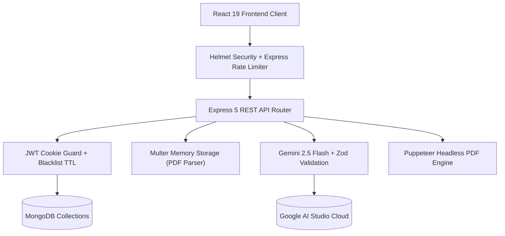

# 🚀 Interview Prep AI — Complete AI Interview Preparation & Career Accelerator SaaS

[](https://nodejs.org/)
[](https://expressjs.com/)
[](https://react.dev/)
[](https://ai.google.dev/)
[](https://www.mongodb.com/)
[]()

> **Interview Prep AI** is a complete, production-ready full-stack SaaS platform designed to transform job seekers into top-tier candidates. Featuring a dark-mode SaaS interface inspired by Linear and Vercel, it combines deep resume parsing, Gemini generative AI, live mock interview simulations with live camera & spoken voice feedback, algorithmic coding practice with 50+ DSA challenges, ATS resume builder, and actionable preparation roadmaps.

---

## 🎯 Key Features & Modules

- 🌟 **Modern SaaS Marketing Landing Page**: High-conversion hero section, interactive laptop preview mockup, feature grid, how it works breakdown, and FAQ accordion.
- 🔐 **Split-Screen Authentication**: Elegant split-screen Login & Registration with password visibility toggles, career role selection, and secure HttpOnly cookie session management.
- 📊 **Dynamic Dashboard**: Time-aware greeting ("Good Evening, [Name]"), real persisted metrics (Total Plans, Avg Match Score, Mock Interviews, Streak), circular progress ring, and recent activity with company logos.
- ✍️ **3-Step Interview Strategy Generator**: Multi-step wizard (Job Details, Resume PDF drag-and-drop / self-description, Review) with multi-stage animated AI progress.
- 📑 **Comprehensive 5-Tab Report Viewer**:
  - **Overview**: 0-100% Match Score ring, breakdown bars (Technical, Experience, Education, Projects, Keywords), and key insights.
  - **Questions**: Technical & STAR behavioral questions with search, difficulty tags, interviewer intentions, model answers, copy button, bookmarking, and an interactive **AI Interview Coach**.
  - **Skill Gaps**: Priority-rated deficiencies (`high`, `medium`, `low`) with why it matters and recommended learning resources.
  - **Roadmap**: Day-by-day 7-day preparation plan with interactive task checkboxes that persist completion in MongoDB.
  - **Resume**: ATS tailored resume preview with 1-click PDF download.
- 🎙️ **Interactive AI Mock Interview**: Timed live mock session featuring an interviewer avatar, speech-to-text dictation, and instant multi-criteria scoring.
- 💻 **Algorithm Coding Practice**: Topic and difficulty problem generator with hints, optimal approaches, reference code, and automated AI code review.
- 📄 **ATS Resume Builder & Optimizer**: Template selector, live resume preview, ATS score compatibility checklist, and Puppeteer PDF export with system browser fallback.
- 🕒 **Interview History & Saved Questions**: Searchable plan archive with company logos, deletion support, and a personal bookmarked question revision deck.
- 📈 **Preparation Analytics**: Historical match score trend SVG line chart, preparation progress metrics, and interview readiness checklist.
- 🔔 **In-App Notifications Center**: Real-time alerts for generated reports, mock interview completions, and streak milestones.
- ⚙️ **Account Settings & Data Privacy**: Profile information updates, password changes, notification preferences, JSON data export, and account deletion.

---

## 🏗️ System Architecture



For the complete technical breakdown, sequence diagrams, and schema references, see [DOCUMENTATION.md](../../DOCUMENTATION.md).

---

## 🚀 Quick Start Guide

### 1. Prerequisites
- **Node.js** v18+ or v22+
- **MongoDB** running locally (`mongodb://localhost:27017/interview_ready_ai`) or a MongoDB Atlas URI
- **Google AI Studio API Key** ([Obtain key here](https://aistudio.google.com/))
- **Google Chrome / Microsoft Edge** installed for PDF generation

---

### 2. Backend Setup

```bash
cd Backend
npm install
cp .env.example .env
```

Configure `Backend/.env`:
```ini
PORT=5000
NODE_ENV=development
MONGO_URI=mongodb://localhost:27017/interview_ready_ai
JWT_SECRET=your_jwt_secret_key_here
GOOGLE_GENAI_API_KEY=your_gemini_api_key_here
GEMINI_MODEL=gemini-2.5-flash
FRONTEND_URLS=http://localhost:5173
```

Start the backend server:
```bash
npm run dev
```

---

### 3. Frontend Setup

In a separate terminal:

```bash
cd Frontend
npm install
cp .env.example .env
```

Ensure `Frontend/.env` contains:
```ini
VITE_API_URL=http://localhost:5000
```

Start the frontend development server:
```bash
npm run dev
```
Open [http://localhost:5173](http://localhost:5173) in your browser.

---

## 📄 License

This project is licensed under the **ISC License**.
